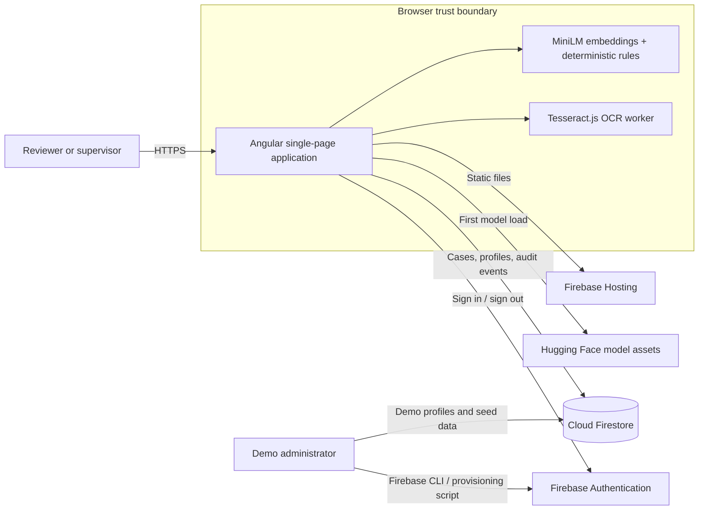
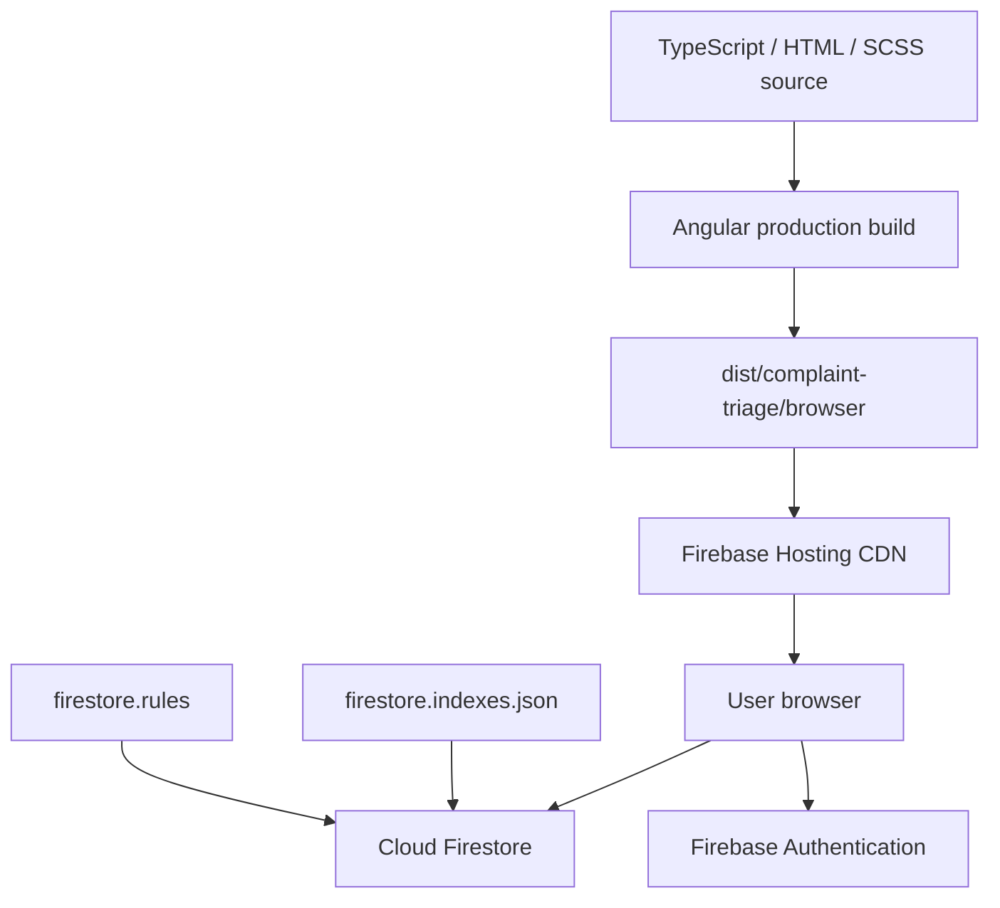
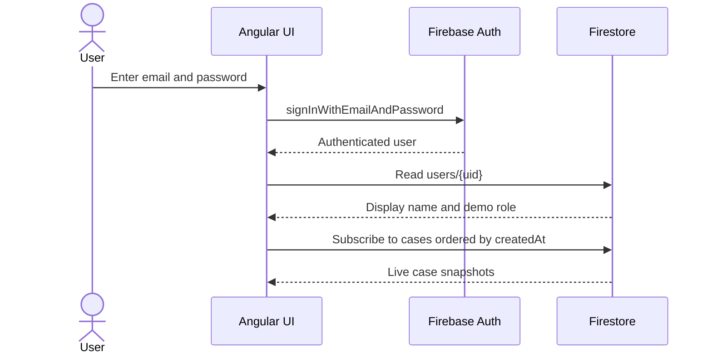
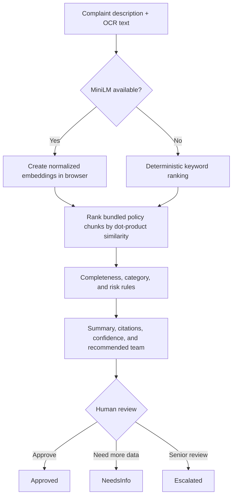
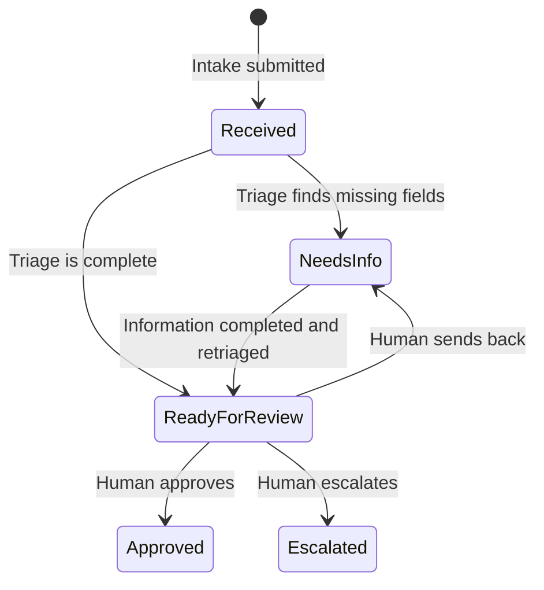

# Complaint Triage Architecture

## 1. Executive summary

Complaint Triage is a **client-heavy, serverless demonstration** of structured complaint
intake, local document processing, grounded policy retrieval, and human review. Angular
runs the workflow in the browser; Firebase Authentication establishes identity; Cloud
Firestore stores cases and audit events; Firebase Hosting serves the static application.

The design deliberately keeps OCR and AI retrieval in the browser. Complaint text is not
sent to a hosted LLM. The browser downloads an open embedding model, ranks a small bundled
fictional policy corpus, applies deterministic risk and completeness rules, and saves a
cited draft for a human reviewer.

This is a fictional-data demonstration, not a production case-management system. The
current security rules provide an authenticated demo boundary but do not enforce production
role-based authorization, tenant isolation, or server-controlled audit integrity.

## 2. Goals and non-goals

### Goals

- Demonstrate a complete intake-to-decision workflow with persisted state.
- Keep OCR and semantic retrieval local to the user's browser.
- Ground every suggested policy section in a known, inspectable source chunk.
- Preserve human control over approval, send-back, and escalation decisions.
- Continue operating when the embedding model cannot be loaded.
- Make the demo inexpensive to host by using a static SPA and managed Firebase services.

### Non-goals

- Production authorization, multi-tenancy, or regulatory compliance.
- Legal conclusions or retrieval from real statutes and policies.
- Durable attachment storage, malware scanning, or document retention.
- External email, queues, workflow engines, or downstream case routing.
- A server-side LLM, vector database, or autonomous decision maker.

## 3. System context



The browser is both the presentation tier and the application-compute tier. Firebase is the
managed identity and persistence tier. Hugging Face serves model assets only; the complaint
content is processed locally after the model is loaded.

## 4. Deployment topology



- **Build artifact:** static HTML, CSS, JavaScript, and browser assets.
- **Hosting:** Firebase Hosting with SPA fallback to `index.html`.
- **Persistence:** the default Firestore database in
  `complaint-triage-demo-2026`.
- **Identity:** Firebase email/password authentication.
- **Security headers:** MIME sniffing protection, a restrictive referrer policy, and a
  permissions policy that disables camera, microphone, and geolocation.
- **Caching:** fingerprinted JavaScript and CSS assets receive a one-year immutable cache
  policy. HTML is not assigned that immutable policy.

## 5. Logical components

| Component | Responsibility | Important dependencies |
|---|---|---|
| `App` | Coordinates views, forms, OCR, triage, and reviewer actions | Angular signals and forms |
| `AuthService` | Observes Firebase auth state and loads the user's demo profile | Firebase Auth, Firestore `users` |
| `CaseService` | Subscribes to cases and persists intake, triage, review, and audit changes | Cloud Firestore |
| `AiTriageService` | Embeds text, ranks policy chunks, applies risk/completeness rules, and creates cited drafts | Transformers.js, bundled policy corpus |
| Tesseract.js worker | Extracts text from selected image files | Browser CPU/WASM worker |
| `sample-data.ts` | Supplies the fictional policy corpus and three fallback/sample cases | Bundled application code |
| Firestore rules | Enforces the current authenticated-demo access boundary | Firebase Authentication |
| Provisioning script | Creates demo users and profile documents using an authenticated Firebase CLI session | Firebase Management APIs |
| Live verification script | Exercises login, intake, retrieval, approval, persistence, and audit events | Chromium, Firebase Web SDK |

The application intentionally uses Angular services rather than a separate backend API. That
keeps the demo small, but also means all business rules and authorization-sensitive operations
must be treated as untrusted client behavior in a production design.

## 6. Runtime flows

### 6.1 Authentication and profile loading



The role in `users/{uid}` controls labels shown in the demo. It is not a secure authorization
claim. If profile loading fails, the UI falls back to a local `Reviewer` profile for display.

### 6.2 Intake and OCR

1. The reviewer enters structured complaint fields.
2. For selected image files, Tesseract.js is loaded dynamically and runs OCR in the browser.
3. The demo retains attachment **names and extracted text**, not the original file bytes.
4. `CaseService.createCase` writes a case document with status `Received`.
5. A `CaseSubmitted` event is appended to the case's `audit` subcollection.

OCR failure is non-fatal. The case can still be submitted without extracted text.

### 6.3 AI-assisted triage



The primary model is `Xenova/all-MiniLM-L6-v2`, loaded through Transformers.js with
quantized weights. The service embeds the complaint and each small policy chunk, then sorts
chunks by vector similarity. If model loading or inference fails, keyword overlap provides a
deterministic fallback.

Retrieval is followed by deterministic logic:

- regular-expression rules assign allegation categories;
- missing teacher, school, or incident-date fields are flagged;
- safety terms raise risk, while privacy/discrimination terms produce medium risk;
- the two highest-ranked policy chunks become source-backed suggestions;
- the recommended team comes from the highest-ranked policy chunk.

The output is a draft. The browser persists it only after retrieval and rule evaluation finish.
No generative model invents policy text; source text comes directly from the bundled corpus.

### 6.4 Human review and audit

The reviewer can approve, send back, or escalate. Each action updates the case and appends a
separate audit event. The event records the action, actor email, optional reviewer notes, and a
server timestamp.

The current case update and audit append are two separate Firestore operations. They are not a
transaction or batch, so a network interruption can leave the case updated without its matching
audit event (or vice versa). Production code should make this a server-authorized atomic write.

## 7. State model



`Processing` and `Routed` exist in the TypeScript domain model for future workflow expansion,
but the current demo does not persist transitions into those states.

## 8. Data model

```text
users/{uid}
  email, displayName, role

cases/{caseId}
  caseNumber
  requesterName, requesterEmail, requesterPhone
  teacherName, school, district, incidentDate
  description, extractedText, attachmentNames[]
  status, riskLevel, confidence
  allegationCategories[], missingFields[]
  aiSummary, suggestedCodes[], recommendedTeam, assignedTeam
  reviewerNotes, createdBy, triagedBy
  createdAt, updatedAt, auditCount

cases/{caseId}/audit/{eventId}
  event, actor, detail, createdAt
```

Firestore server timestamps are used for persisted writes. Sample cases use ISO strings because
they are bundled constants rather than database records. Case numbers contain a time-derived
suffix and are human-friendly identifiers, not uniqueness or authorization keys; Firestore
document IDs remain the primary identifiers.

## 9. Trust boundaries and security posture

### Current controls

- Firebase Authentication is required before cases or profiles can be read.
- A user can read only their own profile document.
- Client writes cannot create arbitrary profile documents.
- Case creation requires `createdBy` to match the authenticated UID.
- Case deletion and audit mutation/deletion are denied.
- Unknown Firestore paths are denied by default.
- Original attachment bytes remain in the browser and are not uploaded.
- Demo credentials are generated outside the repository with owner-only file permissions.

The Firebase web configuration in `environment.ts` is a public client identifier, not an
administrator secret. Security depends on Authentication, Firestore rules, API restrictions,
and project configuration—not on hiding that configuration from the browser.

### Demonstration-only limitations

- Any authenticated demo user can read every case.
- Any authenticated demo user can update a case if `createdBy` is not changed.
- Roles stored in profile documents are not enforced by Firestore rules.
- Any authenticated demo user can append an audit event and choose its actor text.
- Business invariants, allowed status transitions, field shapes, and maximum sizes are not
  validated server-side.
- There is no tenant boundary, App Check, rate limiting, malware scanning, DLP, or retention
  policy.
- OCR text and complaint content are stored in Firestore without application-level encryption.
- The UI fallback to sample data can mask a Firestore outage if the warning is overlooked.

Only fictional data should be used in this deployment.

## 10. Resilience and failure behavior

| Failure | Current behavior | Consequence |
|---|---|---|
| MiniLM asset or inference failure | Switch to deterministic lexical retrieval | Workflow continues with lower-quality ranking |
| OCR failure | Show a warning and allow submission | Reviewer can continue without extracted text |
| Firestore subscription failure | Display the three fictional sample cases | Demo remains explorable; writes may still fail |
| Authentication failure | Display a generic sign-in error | No case subscription starts |
| Case write failure | Keep UI open and show a retry message | No optimistic success is claimed |
| Audit append fails after case update | No rollback | Case/audit consistency can diverge |
| Browser refresh | Rehydrate identity and cases from Firebase | Unsaved form input is lost |

The embedding model's first load has the highest latency and bandwidth cost. Later loads may
benefit from browser caching. Inference and OCR consume client CPU and memory, so performance
depends on the user's device.

## 11. Verification strategy

Three layers provide confidence:

1. **Angular unit tests** validate component creation, login rendering, and authenticated UI
   behavior.
2. **Production build** validates Angular templates, TypeScript, dependency bundling, and output
   generation.
3. **Live end-to-end verification** uses Chromium against Firebase Hosting, signs in as Reviewer
   and Supervisor, creates a fictional case, runs retrieval, approves it, reloads the page, and
   checks the case plus all three expected audit events directly in Firestore.

The live script intentionally creates a fictional verification case on each run. Credentials are
read from `~/.config/complaint-triage/demo-accounts.json` and never from the repository.

## 12. Production evolution path

Before real complaint or student data is introduced:

1. Put privileged workflow mutations behind a trusted API, Cloud Functions, or Cloud Run service.
2. Enforce roles with Firebase custom claims and server-side authorization; model submitters,
   reviewers, supervisors, and administrators separately.
3. Replace broad case reads with tenant- and assignment-scoped queries and matching rules.
4. Make case transitions and audit appends atomic, server-timestamped, immutable, and attributable
   from the authenticated principal rather than client-provided strings.
5. Validate schemas, state transitions, field lengths, file types, and citation identifiers on the
   server.
6. Add encrypted attachment storage, malware scanning, retention/deletion policies, and legal-hold
   controls.
7. Version the real policy corpus, preserve retrieval provenance, measure retrieval quality, and
   require human confirmation for every disposition.
8. Add App Check, abuse controls, structured observability, alerting, backups, and disaster-recovery
   exercises.
9. Add CI for unit tests, build, dependency review, Firestore rules tests, and emulator-based
   integration tests.
10. Complete a privacy, accessibility, threat-model, and regulatory review before launch.

## 13. Repository map

```text
src/app/app.*                    Main Angular shell and workflow UI
src/app/services/auth.service.ts Authentication and profile state
src/app/services/case.service.ts Firestore reads, writes, and audit events
src/app/services/ai-triage.*     Browser embedding retrieval and rules
src/app/data/sample-data.ts      Fictional policy corpus and sample cases
src/app/models.ts                Domain types
src/environments/environment.ts  Public Firebase web configuration
scripts/provision-demo-users.mjs Demo identity/profile provisioning
scripts/verify-live.mjs          Live end-to-end verification
firestore.rules                  Firestore authorization rules
firebase.json                    Hosting and deployment configuration
```

## 14. Key architectural decisions

| Decision | Rationale | Trade-off |
|---|---|---|
| Browser-side OCR and embeddings | Minimizes disclosure to AI services and avoids inference infrastructure | Higher client resource use and model-download latency |
| Bundled policy corpus | Makes citations deterministic and inspectable | Corpus updates require an application release |
| Lexical fallback | Preserves a usable demo when model assets fail | Ranking quality is less semantic |
| Firestore real-time subscription | Keeps the review queue current with little infrastructure | Client security rules become critical |
| Append-only audit subcollection | Makes workflow history easy to inspect | Client-created events are not sufficient for production integrity |
| Static Firebase Hosting | Low operational cost and simple deployment | No trusted application tier for business invariants |

These decisions are appropriate for a transparent fictional-data prototype. The production
evolution path deliberately adds a trusted server boundary while preserving local OCR/retrieval
where privacy and device capacity make that beneficial.
