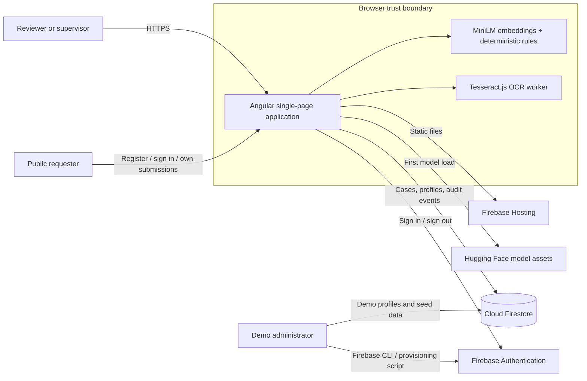
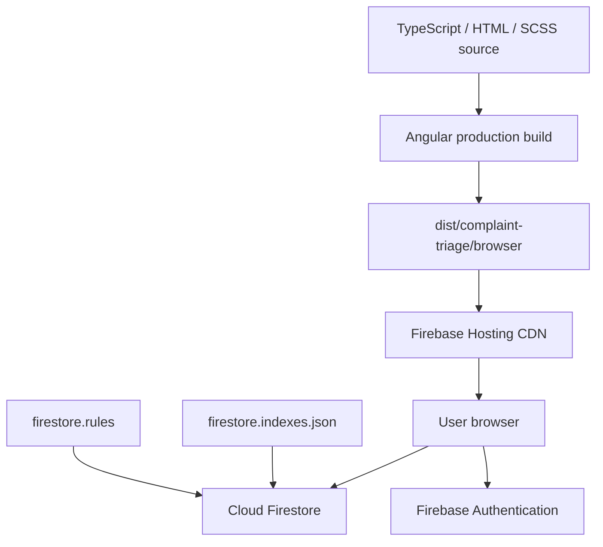
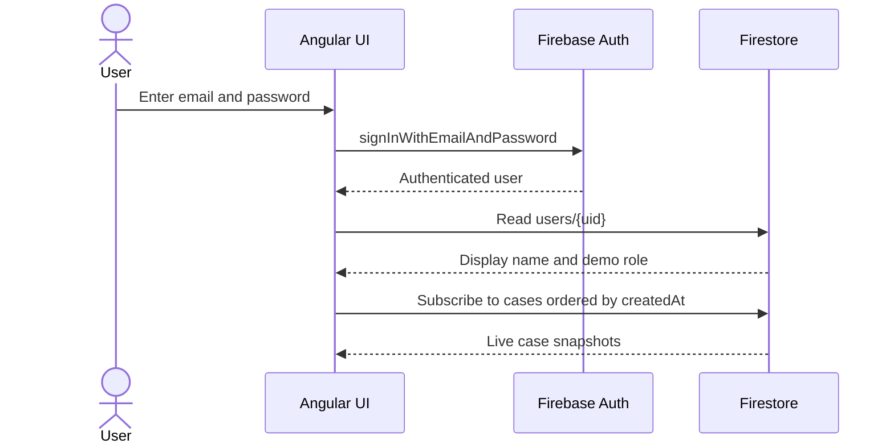
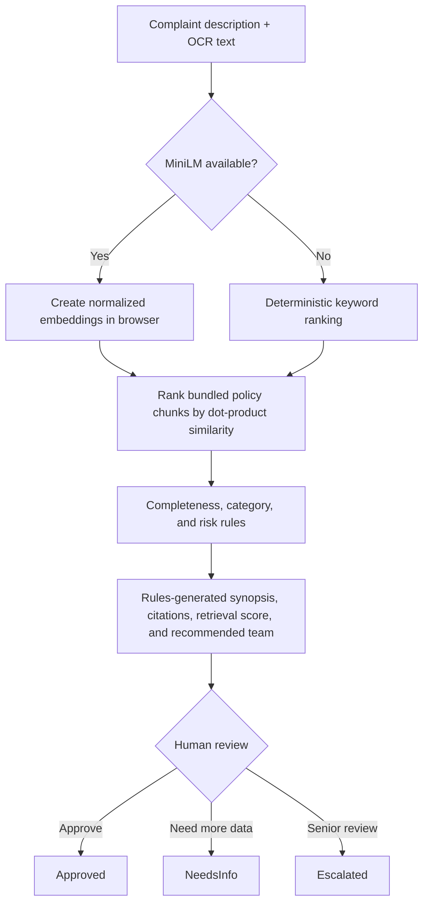
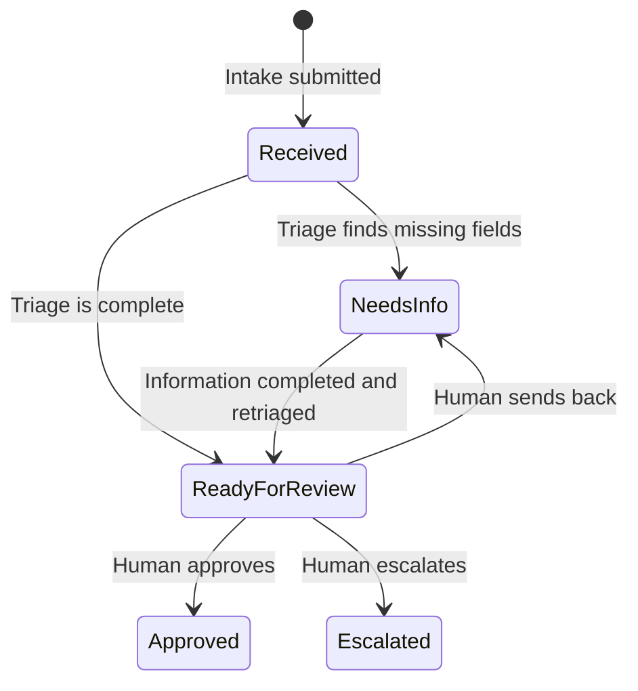

# Complaint Triage Architecture

## 1. Executive summary

Complaint Triage is a **client-heavy, serverless demonstration** of requester-authenticated public
intake, staff review, local document processing, grounded policy retrieval, and human review. Angular
runs the workflow in the browser; Firebase Authentication establishes identity; Cloud
Firestore stores cases and audit events; Firebase Hosting serves the static application.

The design deliberately keeps OCR and embedding retrieval in the browser. Complaint text is not
sent to a hosted LLM. The browser downloads an open embedding model, ranks a small bundled
fictional policy corpus, applies deterministic risk, category, completeness, synopsis, and team
rules, and saves cited triage results for a human reviewer. **No generative LLM is used.**

This is a fictional-data demonstration, not a production case-management system. The
current security rules provide an authenticated staff-demo boundary, bind audit actor identity to
Firebase Authentication, and require atomic case/audit writes. They do not enforce production
assignment scope, tenant isolation, or server-controlled workflow integrity.

## 2. Goals and non-goals

### Goals

- Demonstrate a complete intake-to-decision workflow with persisted state.
- Separate public requester intake and owner-only status visibility from internal staff review.
- Keep OCR and semantic retrieval local to the user's browser.
- Ground every suggested policy section in a known, inspectable source chunk.
- Preserve human control over approval, send-back, and escalation decisions.
- Continue operating when the embedding model cannot be loaded.
- Make the demo inexpensive to host by using a static SPA and managed Firebase services.

### Non-goals

- Production authorization, multi-tenancy, or regulatory compliance.
- Legal conclusions or retrieval from real statutes and policies.
- Durable attachment storage, malware scanning, or document retention.
- External email, queues, workflow engines, or downstream case routing.
- A server-side LLM, vector database, or autonomous decision maker.

## 3. System context



The browser is both the presentation tier and the application-compute tier. Firebase is the
managed identity and persistence tier. Hugging Face serves model assets only; the complaint
content is processed locally after the model is loaded.

## 4. Deployment topology



- **Build artifact:** static HTML, CSS, JavaScript, and browser assets.
- **Hosting:** Firebase Hosting with SPA fallback to `index.html`.
- **Persistence:** the default Firestore database in
  `complaint-triage-demo-2026`.
- **Identity:** Firebase email/password authentication.
- **Security headers:** MIME sniffing protection, a restrictive referrer policy, and a
  permissions policy that disables camera, microphone, and geolocation.
- **Caching:** fingerprinted JavaScript and CSS assets receive a one-year immutable cache
  policy. HTML is not assigned that immutable policy.

## 5. Logical components

| Component                | Responsibility                                                                                        | Important dependencies                 |
| ------------------------ | ----------------------------------------------------------------------------------------------------- | -------------------------------------- |
| `App`                    | Coordinates views, forms, OCR, triage, and reviewer actions                                           | Angular signals and forms              |
| `AuthService`            | Registers Requesters, signs in all roles, and requires a Firestore profile                            | Firebase Auth, Firestore `users`       |
| `CaseService`            | Uses owner-filtered Requester queries, staff-wide queues, and atomic workflow writes                  | Cloud Firestore                        |
| `PolicyTriageService`    | Embeds text, ranks policy chunks, and applies explicit risk/category/completeness/synopsis/team rules | Transformers.js, bundled policy corpus |
| Tesseract.js worker      | Extracts text from selected image files                                                               | Browser CPU/WASM worker                |
| `sample-data.ts`         | Supplies the fictional policy corpus and three fallback/sample cases                                  | Bundled application code               |
| Firestore rules          | Enforces the current authenticated-demo access boundary                                               | Firebase Authentication                |
| Provisioning script      | Creates demo users and profile documents using an authenticated Firebase CLI session                  | Firebase Management APIs               |
| Live verification script | Exercises login, intake, retrieval, approval, persistence, and audit events                           | Chromium, Firebase Web SDK             |

The application intentionally uses Angular services rather than a separate backend API. That
keeps the demo small, but also means all business rules and authorization-sensitive operations
must be treated as untrusted client behavior in a production design.

## 6. Runtime flows

### 6.1 Authentication and profile loading



The role in `users/{uid}` is checked by Firestore rules. Requesters can self-create only their own
profile with role `Requester`; staff profiles are provisioned administratively. A Requester query
must filter `createdBy` to the authenticated UID, while staff roles can query the shared queue. A
missing profile fails closed and signs the user out—there is no privileged local role fallback.

### 6.2 Intake and OCR

1. A Requester can register/sign in and enter a complaint through public intake; authenticated
   staff can also enter one on a caller's behalf.
2. Requesters see only their own submissions. They do not receive audit events, internal
   risk/retrieval details, reviewer notes, triage controls, or disposition controls.
3. For selected image files, Tesseract.js is loaded dynamically and runs OCR in the browser.
4. The demo retains attachment **names and extracted text**, not the original file bytes.
5. `CaseService.createCase` generates a Firestore document ID and derives the display case number
   from its first eight characters rather than a collision-prone timestamp suffix.
6. A Firestore write batch creates the case and its linked `CaseSubmitted` audit event atomically.

OCR failure is non-fatal. The case can still be submitted without extracted text.

### 6.3 Browser-local policy retrieval and deterministic triage



The primary model is `Xenova/all-MiniLM-L6-v2`, loaded through Transformers.js with
quantized weights. The service sends the complaint description plus OCR text (up to 4,000
characters) to the local feature-extraction pipeline. MiniLM returns a normalized numeric vector,
not generated text or JSON. The five bundled policy chunks are embedded once per page session and
cached in memory; each complaint vector is compared with those cached vectors. If model loading or
inference fails, normalized keyword overlap provides a deterministic fallback.

Retrieval is followed by deterministic logic:

- regular-expression rules assign allegation categories;
- missing teacher, school, or incident-date fields are flagged;
- safety terms raise risk, while privacy/discrimination terms produce medium risk;
- the two highest-ranked policy chunks become source-backed suggestions;
- the recommended team comes from the highest-ranked policy chunk.

The displayed retrieval score is the top similarity value. It is not a calibrated confidence
estimate. No prompt or generated completion exists: the synopsis is a fixed template populated
from deterministic categories and missing fields, while source text and IDs come directly from
the bundled corpus. The browser persists the typed result only after retrieval and rule evaluation
finish, and a human controls the disposition.

### 6.4 Human review and audit

The reviewer can approve, send back, or escalate. Each intake, triage, or review mutation uses one
Firestore write batch containing both the case change and a new audit document. `auditCount` uses
Firestore `increment(1)`. The case stores the generated `lastAuditId`; rules require that document
to be newly created in the same atomic request. Audit rules also require `actorUid` and actor email
to match `request.auth`, and prevent audit updates/deletes.

This prevents a half-completed client write and blocks standalone or impersonated audit events.
It does not make a browser client a trusted workflow engine; production should still move state
transitions behind a server-authorized boundary.

## 7. State model



The demo intentionally has no `Routed` state because no external routing integration exists.
Approval saves the recommended team assignment and reports exactly that outcome.

## 8. Data model

```text
users/{uid}
  email, displayName, role, createdAt

cases/{caseId}
  caseNumber
  requesterName, requesterEmail, requesterPhone
  teacherName, school, district, incidentDate
  description, extractedText, attachmentNames[]
  status, riskLevel, retrievalScore
  allegationCategories[], missingFields[]
  triageSummary, suggestedCodes[], recommendedTeam, assignedTeam, retrievalMethod
  reviewerNotes, createdBy, triagedBy
  createdAt, updatedAt, auditCount, lastAuditId

cases/{caseId}/audit/{eventId}
  event, actor, actorUid, detail, createdAt
```

Firestore server timestamps are used for persisted writes. Sample cases use ISO strings because
they are bundled constants rather than database records. Case numbers use the year plus the first
eight characters of the already-generated random Firestore document ID. The full Firestore ID
remains the primary identifier.

## 9. Trust boundaries and security posture

### Current controls

- Firebase Authentication is required before cases or profiles can be read.
- A user can read only their own profile document.
- Client writes cannot create arbitrary profile documents.
- A new user can create only their own `Requester` profile with an email matching the auth claim.
- Requesters can query only cases whose `createdBy` equals their UID and cannot read audit events.
- Requesters can create only `Received`/`Unscored` cases with empty internal result fields.
- Staff writes require an allowed role from the caller's own profile document.
- Case creation requires `createdBy` to match the authenticated UID.
- Every case mutation must atomically create a newly linked audit document.
- Audit actor UID and email must match Firebase Authentication claims.
- Case deletion and audit mutation/deletion are denied.
- Unknown Firestore paths are denied by default.
- Original attachment bytes remain in the browser and are not uploaded.
- Demo credentials are generated outside the repository with owner-only file permissions.

The Firebase web configuration in `environment.ts` is a public client identifier, not an
administrator secret. Security depends on Authentication, Firestore rules, API restrictions,
and project configuration—not on hiding that configuration from the browser.

### Demonstration-only limitations

- Any authenticated staff demo user can read every case and mutate allowed workflow fields.
- Roles are broad demo roles, not assignment-scoped or tenant-scoped authorization.
- A malicious staff client can still choose an allowed event/detail and attempt allowed state
  fields, although it cannot impersonate the audit actor or separate the event from the case write.
- Business invariants, allowed status transitions, field shapes, and maximum sizes are not
  validated server-side.
- There is no tenant boundary, App Check, rate limiting, malware scanning, DLP, or retention
  policy.
- Requester registration does not require verified email and has no bot/abuse controls in this demo.
- OCR text and complaint content are stored in Firestore without application-level encryption.
- The UI fallback to sample data can mask a Firestore outage if the warning is overlooked.

Only fictional data should be used in this deployment.

## 10. Resilience and failure behavior

| Failure                               | Current behavior                           | Consequence                                    |
| ------------------------------------- | ------------------------------------------ | ---------------------------------------------- |
| MiniLM asset or inference failure     | Switch to deterministic lexical retrieval  | Workflow continues with lower-quality ranking  |
| OCR failure                           | Show a warning and allow submission        | Reviewer can continue without extracted text   |
| Firestore subscription failure        | Display the three fictional sample cases   | Demo remains explorable; writes may still fail |
| Authentication failure                | Display a generic sign-in error            | No case subscription starts                    |
| Case write failure                    | Keep UI open and show a retry message      | No optimistic success is claimed               |
| Any write in a case/audit batch fails | Entire batch is rejected                   | Case and audit remain consistent               |
| Browser refresh                       | Rehydrate identity and cases from Firebase | Unsaved form input is lost                     |

The embedding model's first load has the highest latency and bandwidth cost. Later loads may
benefit from browser caching. Inference and OCR consume client CPU and memory, so performance
depends on the user's device.

## 11. Verification strategy

Three layers provide confidence:

1. **Angular unit tests** validate component creation plus semantic-result labeling, deterministic
   fallback behavior, risk/category/citation rules, and policy-embedding cache reuse.
2. **Production build** validates Angular templates, TypeScript, dependency bundling, and output
   generation.
3. **Live end-to-end verification** uses Chromium against Firebase Hosting, signs in as Requester,
   Reviewer, and Supervisor, proves the requester lacks staff controls, creates a fictional case,
   runs retrieval, approves it, reloads the page, and checks the case plus all three expected audit
   events directly in Firestore.

The live script intentionally creates a fictional verification case on each run. Credentials are
read from `~/.config/complaint-triage/demo-accounts.json` and never from the repository.

## 12. Production evolution path

Before real complaint or student data is introduced:

1. Put privileged workflow mutations behind a trusted API, Cloud Functions, or Cloud Run service.
2. Enforce roles with Firebase custom claims and server-side authorization; model submitters,
   reviewers, supervisors, and administrators separately.
3. Replace broad case reads with tenant- and assignment-scoped queries and matching rules.
4. Move the already-atomic case/audit mutations behind a trusted service that validates the full
   state machine and derives all audit fields server-side.
5. Validate schemas, state transitions, field lengths, file types, and citation identifiers on the
   server.
6. Add encrypted attachment storage, malware scanning, retention/deletion policies, and legal-hold
   controls.
7. Version the real policy corpus, preserve retrieval provenance, measure retrieval quality, and
   require human confirmation for every disposition.
8. Add App Check, abuse controls, structured observability, alerting, backups, and disaster-recovery
   exercises.
9. Require verified requester email, consent/retention acknowledgement, duplicate/spam detection,
   and accessible account recovery before opening public intake.
10. Add CI for unit tests, build, dependency review, Firestore rules tests, and emulator-based
    integration tests.
11. Complete a privacy, accessibility, threat-model, and regulatory review before launch.

## 13. Repository map

```text
src/app/app.*                    Main Angular shell and workflow UI
src/app/services/auth.service.ts Authentication and profile state
src/app/services/case.service.ts Firestore reads, writes, and audit events
src/app/services/policy-triage.* Browser embedding retrieval and transparent rules
src/app/data/sample-data.ts      Fictional policy corpus and sample cases
src/app/models.ts                Domain types
src/environments/environment.ts  Public Firebase web configuration
scripts/provision-demo-users.mjs Demo identity/profile provisioning
scripts/verify-live.mjs          Live end-to-end verification
firestore.rules                  Firestore authorization rules
firebase.json                    Hosting and deployment configuration
```

## 14. Key architectural decisions

| Decision                          | Rationale                                                               | Trade-off                                                                        |
| --------------------------------- | ----------------------------------------------------------------------- | -------------------------------------------------------------------------------- |
| Browser-side OCR and embeddings   | Minimizes disclosure to AI services and avoids inference infrastructure | Higher client resource use and model-download latency                            |
| Bundled policy corpus             | Makes citations deterministic and inspectable                           | Corpus updates require an application release                                    |
| Lexical fallback                  | Preserves a usable demo when model assets fail                          | Ranking quality is less semantic                                                 |
| Firestore real-time subscription  | Keeps the review queue current with little infrastructure               | Client security rules become critical                                            |
| Atomic linked audit subcollection | Prevents half-writes and binds actor identity                           | Client-selected state transitions still need a trusted production service        |
| Static Firebase Hosting           | Low operational cost and simple deployment                              | No trusted application tier for business invariants                              |
| Requester/staff separation        | Keeps public intake away from internal review data                      | Production still needs verified identity, abuse controls, and assignment scoping |
| TEA-inspired visual system        | Uses Open Sans and the published palette for familiar Texas context     | Explicit non-affiliation notice and no TEA logo are required                     |

These decisions are appropriate for a transparent fictional-data prototype. The production
evolution path deliberately adds a trusted server boundary while preserving local OCR/retrieval
where privacy and device capacity make that beneficial.
